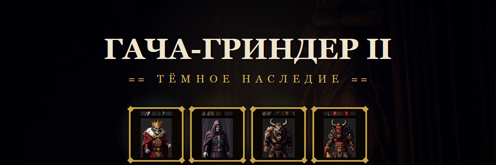
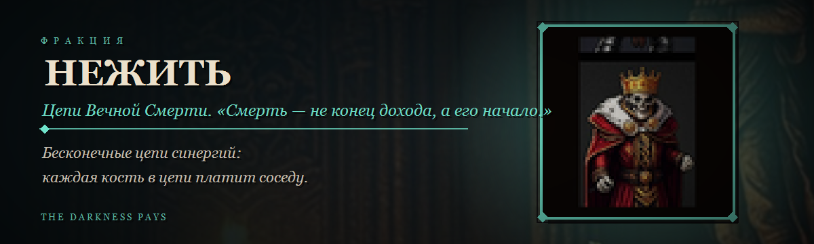
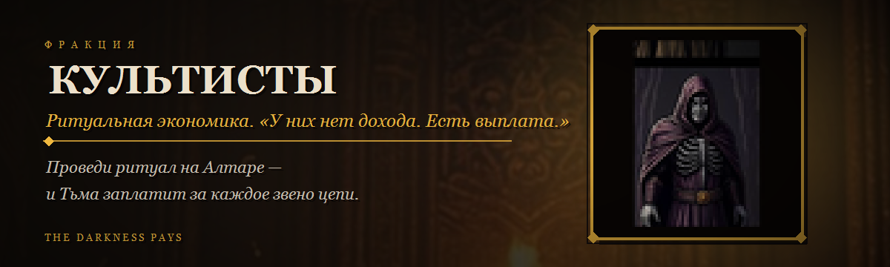
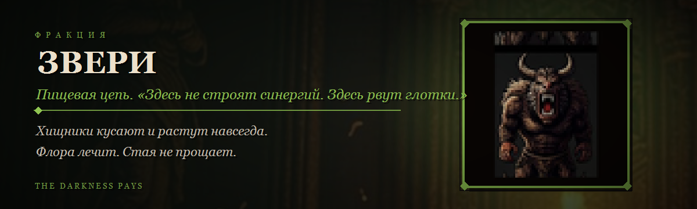
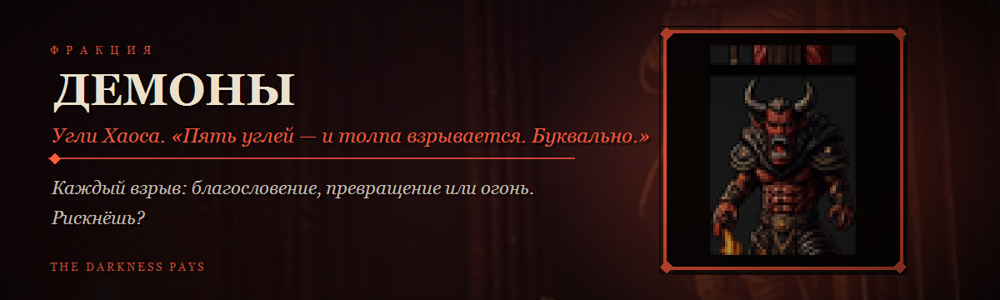

# ⚜ ГАЧА-ГРИНДЕР 2: ТЁМНОЕ НАСЛЕДИЕ

> ### *Внизу, где не достаёт солнце, есть святилище, где тишину давно убили.*
> ### *Каждую ночь Псалмопевец поднимается на костяную кафедру и дует в золотую трубу —*
> ### *и Тьма платит кристаллами. **Собери свой хор. Эпохи ждут.***

**▶ ИГРАТЬ** — откройте `index.html` · GitHub Pages подхватывает всё автоматически · *без установки, без аккаунтов, без серверов*

**Текущая версия: v1.2.9 «Тёмный Пакт»**

---

## 🕯 ЭТО ИГРА, В КОТОРОЙ

| ТЬМА | ПЛАТИТ |
|:---:|:---:|
| **ВЕРНО** | **ЗА ВСЁ** |

**КРУТИ.** Гача выдаёт карты только твоей фракции — от ритуальных зданий до легендарных ★5.
**СТАВЬ.** Карты на Алтаре соединяются в *звенья* — живые синергии, и каждая капля кристаллов идёт в порог Эпохи.
**СЛУШАЙ.** Повторять одну и ту же пару — провально: затухание съедает прибыль. *Уникальный* хор синергий усиливает весь доход.
**ВОЗНЕСИ.** Порог пройден — новая Эпоха: поле растёт, механики распахиваются, а печати 🔱 остаются с тобой навсегда.

---

## ⛓ ЧЕТЫРЕ АРМИИ ТЬМЫ. ЧЕТЫРЕ ЭКОНОМИКИ. НИ ОДНОЙ ПОХОЖЕЙ.

**Нежить не умирает. Нежить *аккумулируется*.**
Цепи синергий тянутся через всё поле, не разрываясь; армия по своей цепи — это множитель непрерывности.

**Культисты не зарабатывают. Культисты *отчитываются*.**
Никакого дохода. Никаких синергий. Только *ритуал* на Алтаре — и выплата, от которой вздрагивает порог Эпохи.

**Звери не строят планов. Звери *рвут глотки*.**
Хищник убил — стал навсегда сильнее. Не убил — *голодает*. Флора — единственный мир в пропасти клыков.

**Демоны не копят синергии. Демоны копят *угли*.**
Пятый уголёк в толпе — и взрыв: благословение, превращение или огонь. Ты сам выбираешь, насколько тебе не повезёт.

---

## 🔥 ЗА ОДИН ЗАБЕГ

> **60 карт** с личными механиками · **28 реликвий**-двойного-дна · **56 достижений** · казино ·
> **Колыбель Войны** — автобатлер-подземелье, где отряды из твоих карт дерутся сами, а Мощь Алтаря
> напрямую переводит твой доход в урон · **11 именованных Эпох** · ритуальные здания · элитные волны ·
> серия побед · знамения судьбы · ежедневный дар Тьмы · всё озвучено мягкими синтезированными звуками,
> всё дышит — движущимися аурами, живыми ритуалами и пиксель-артом.

> ### *Построй композицию. Проведи ритуал. Дай Псалмопевцу сыграть сольное.*

---

## 📜 ПАТЧНОТ

### v1.2.9 — «ТЁМНЫЙ ПАКТ» ✅
- **Контракты Эпохи:** 6 заданий за забег (из пула 12), награды мимо порога Эпохи; все шесть — «ПАКТ ИСПОЛНЕН» +1 🔱.
- **Знамение Судьбы:** первый вход за день — +5 круток и доход ×2 на 5 минут.
- **Хроники Тьмы:** печати за ПОЛНЫЕ коллекционные наборы (16 вершин, конфетти в конце).
- Анти-спам тостов, QoL авто-стака культистов, подтверждён провод ритуала сквозь здания.

### v1.2.7 — «ПЕПЕЛ И ПОРЯДОК» ✅
- Баланс ритуала (циклы 25–45с, кап ×4, стаки усиливают); формации без пустых клеток; ВНЕШНИЙ КРУГ служителей.
- Самовосстановление рендера поля; интерфейс — без прокрутки страницы.

### v1.2.6 — «КРОВЬ РИТУАЛА» ✅
- **Культисты пересобраны:** роли «заряд ⚡ / выплата 💰», формации = множители скорости, шкала больше НЕ тает.
- Реликвии — чистые баффы без штрафов; продажа дубликатов; честный порог Эпохи (только доход Алтаря).

### v1.2.5 — «ЗДАНИЯ ТЬМЫ» ✅
- **Новый тип карт «Здание»:** 12 построек, по 3 на фракцию (Кладбище, Обелиск, Вольер, Врата Ада и др.).
- Редкости пересобраны (★3 = стандарт); ★5 Хтонь может заменить Алтарь; реликвии — расходник забега.

### v1.2 — «КОЛЫБЕЛЬ ВОЙНЫ» ✅
- **Автобатлер:** элитные волны, серия побед, босс позволяет выбрать трофей (Добыча / Реликвия / 15 круток).
- Награды Арены растут с Эпохой; 4 проклятые реликвии; **Псалмопевец** и **Служка Полой Луны**.

### v1.1 — «КРОВАВЫЙ КЛЫК» ✅
- Хищники летальнее: укус ×50% HP, бафф за убийство навсегда. +6 зверей (Лань, Буйвол, Шерстистый Колосс…).
- Демоны с ролями: Мучитель, Пепельный Тиран, Кулак Пекла (★5), Иссушитель.

### v1.0 — «ШЁПОТ ТЬМЫ» ✅
- Аудио с нуля: 10 мягких звуков и тёплый дрон-эмбиент вместо «пулемётных» пиков.
- Ритуал стал живым (Резонанс и ВСПЛЕСК); формация «Ромб»; кривая Эпох без стен; шрифт Philosopher.

### 🧭 Следующие патчи
- **v1.3 «Смешанные крови»** — гибридные фракции МЁРТВАЯ РОЩА и ХАОС.
