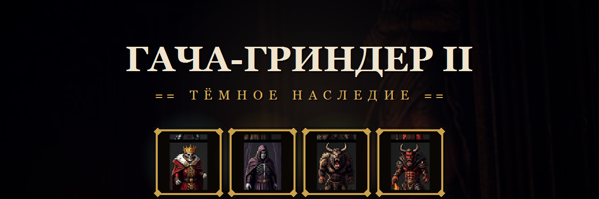
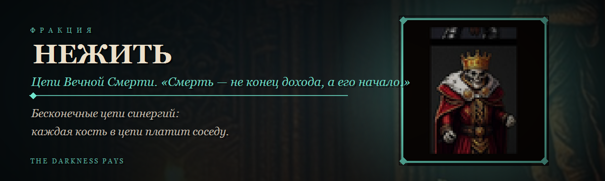
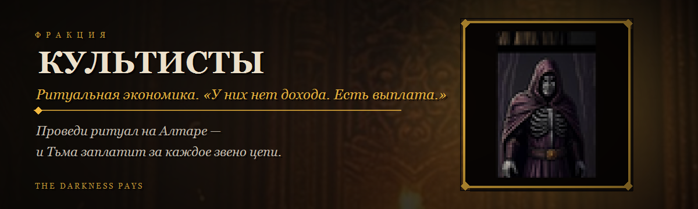
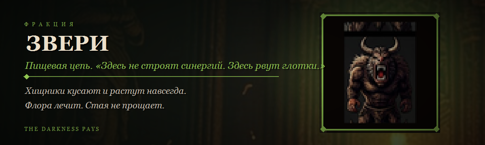
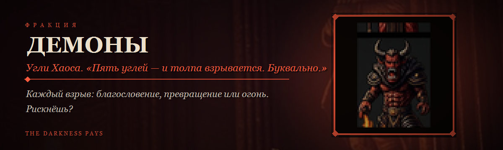

# ⚜ ГАЧА-ГРИНДЕР 2: ТЁМНОЕ НАСЛЕДИЕ

> ### *Внизу, где не достаёт солнце, есть святилище, где тишину давно убили.*
> ### *Каждую ночь Псалмопевец поднимается на костяную кафедру и дует в золотую трубу —*
> ### *и Тьма платит Тёмной энергией. **Собери свой хор. Эпохи ждут.***

**▶ ИГРАТЬ** — откройте `index.html` · GitHub Pages подхватывает всё автоматически · *без установки, без аккаунтов, без серверов*

**Текущая версия: v1.8.0 «Вечная Эпоха»**

---

## 🕯 ЭТО ИГРА, В КОТОРОЙ

| ТЬМА | ПЛАТИТ |
|:---:|:---:|
| **ВЕРНО** | **ЗА ВСЁ** |

**КРУТИ.** Гача выдаёт карты только твоей фракции — от ритуальных зданий до легендарных ★5.
**СТАВЬ.** Карты на Алтаре соединяются в *звенья* — живые синергии, и каждая капля Тёмной энергии идёт в порог Эпохи.
**СЛУШАЙ.** Повторять одну и ту же пару — провально: затухание съедает прибыль. *Уникальный* хор синергий усиливает весь доход.
**ВОЗНЕСИ.** Порог пройден — новая Эпоха: поле растёт, механики распахиваются, а печати 🔱 остаются с тобой навсегда.

---

## ⛓ ЧЕТЫРЕ АРМИИ ТЬМЫ. ЧЕТЫРЕ ЭКОНОМИКИ. НИ ОДНОЙ ПОХОЖЕЙ.

**Нежить не умирает. Нежить *аккумулируется*.**
Цепи синергий тянутся через всё поле, не разрываясь; армия по своей цепи — это множитель непрерывности.

**Культисты не зарабатывают. Культисты *отчитываются*.**
Никакого дохода. Никаких синергий. Только *ритуал* на Алтаре — и выплата, от которой вздрагивает порог Эпохи.

**Звери не строят планов. Звери *рвут глотки*.**
Хищник убил — стал навсегда сильнее. Не убил — *голодает*. Флора — единственный мир в пропасти клыков.

**Демоны не копят синергии. Демоны копят *угли*.**
Пятый уголёк в толпе — и взрыв: благословение, превращение или огонь. Ты сам выбираешь, насколько тебе не повезёт.

---

## 🔥 ЗА ОДИН ЗАБЕГ

> **60 карт** с личными механиками · **28 реликвий**-двойного-дна · **56 достижений** · казино ·
> **Колыбель Войны** — автобатлер-подземелье, где отряды из твоих карт дерутся сами, а Мощь Алтаря
> напрямую переводит твой доход в урон · **11 именованных Эпох** · ритуальные здания · элитные волны ·
> серия побед · знамения судьбы · ежедневный дар Тьмы · всё озвучено мягкими синтезированными звуками,
> всё дышит — движущимися аурами, живыми ритуалами и пиксель-артом.

> ### *Построй композицию. Проведи ритуал. Дай Псалмопевцу сыграть сольное.*

---

## 📜 ПАТЧНОТ

### v1.8.0 — «ВЕЧНАЯ ЭПОХА» (эпохи бесконечны, всё покупается Душами; 80 контрактов нежити; колода — отдельными копиями) ✅

- **ИЗ МЕНЮ ЭПОХИ УБРАНЫ ВСЕ ГРЕЙДЫ**: список «Разблокировок» и
  магазин печатей удалены. ЭПОХИ БЕСКОНЕЧНЫ — дальше таблицы имён
  порог растёт множителем ×4 (как раньше за Гранью); награда
  Вознесения — +1 Душа. Меню Эпохи теперь: прогресс порога, вехи
  забега, кнопка Вознесения.
- **ПЕЧАТИ 🔱 («ЭССЕНЦИЯ») УДАЛЕНЫ ИЗ ИГРЫ**. Бонусы бывшего
  магазина печатей (Изобилие/Жадность/Импульс/Зодчего/Судьбы)
  переехали в «✦ Улучшения» — цены теперь в ДУШАХ. Печати убраны
  из HUD, наград Эпох, Хроник Тьмы (теперь платят Душами 2/2/3/5),
  Пакта (все 4 контракта → +2 Души) и ачивок («Копилка Душ» — 100
  Душ за всё время, «Души под замком» — 500).
- **«✦ УЛУЧШЕНИЯ» — РАБОЧАЯ МАСТЕРСКАЯ** (Меню → Улучшения), всё
  за Души: ⚔ Колыбель Войны (10), 🎰 Казино (20), 🧱 Поле 5×5/7×7/9×9
  (15/40/90, последовательно), 🎲 ★4 (25) и ★5 (70) в Призыве,
  ⚜ Фракции Культисты/Звери/Демоны (30/50/80), 📈 бонусы
  (Изобилие 6·ур, Жадность 5·ур, Импульс 4·ур, Зодчего 15/30 —
  поднимает максимальный стак колоды до ×6/×7, Судьбы 8·ур).
  ЭССЕНЦИЯ больше не существует; поле больше не растёт от Эпох.
  РАЗОВАЯ МИГРАЦИЯ: открывавшееся Эпохами переводится в покупки
  бесплатно по рекорду Эпох (gg3_mig18).
- **РЕЛИКВИИ — ЗАГЛУШКА В «УЛУЧШЕНИЯХ»**: способа получить
  реликвии пока НЕТ (так и задумано, доработаем позже). Из Призыва
  реликвии больше не падают (схрон удалён), трофей босса не
  предлагает реликвию (два варианта ТЭ), вкладка реликвий в
  коллекции забега видна только при наличии реликвий. Слоты
  столбов, законы и кары ждут своего часа в коде.
- **КОЛОДА — КАЖДАЯ КОПИЯ ОТДЕЛЬНЫМ БЛОКОМ** (уточнение ТЗ):
  КЛИК ПО КАРТЕ В ГРИМУАРЕ добавляет её КАК ДУБЛИКАТ (новый блок
  ×1 в списке колоды), а КЛИК ПО ФИОЛЕТОВОЙ СТРЕЛКЕ ▲ стакаает
  ИМЕННО ТУ КОПИЮ, на которую кликнули (+1 из коллекции, до ×5;
  улучшение «Зодчего» поднимает потолок до ×6/×7). Отдельные
  записи ×1 остаются одиночками — сам решаешь, что стакать.
  Сейф-формат колод — записи {id, n}; старые плоские колоды
  мигрируют автоматически.
- **ВЫБОР КОЛОДЫ ОБЯЗАТЕЛЕН**: при выборе расы на Эпоху
  (Вознесение / Рестарт / Новая игра) открывается окно выбора
  колоды этой расы — забег получит её целиком. Пустая колода —
  с подтверждением (выдастся стартовый набор). Из окна можно
  уйти «Собрать в Гримуаре» и вернуться.
- **80 КОНТРАКТОВ НЕЖИТИ** (data/contracts_undead.js): 60 обычных
  (1 Душа), 15 сложных (2 Души), 5 очень сложных (3 Души). На
  забег случайно выпадает 4 контракта из пула — сложность как
  повезёт, все 4 активны сразу (раньше было 6/3 с перевыдачей).
  **ГЛАВНОЕ ПРАВИЛО**: контракт может выпасть ТОЛЬКО если он
  выполним с колодой, с которой игрок начал Эпоху — у контрактов
  есть req-требования (нужные карты, число копий под стак,
  постройки), сверяемые со снапшотом стартовой колоды (runDeck).
  Сложность подсвечена рамкой блока (золото/пурпур). Контракты с
  Ареной/Казино выпадают только при купленной фиче. Для остальных
  рас пока действует общий пул (11 шаблонов) — пулы фракций
  допишем позже.
- Прочее: чип печатей убран из HUD; кнопка меню Эпохи — «порог,
  вехи»; ачивка «Расширитель» — за покупку 5×5; версии ?v=1.8.0.

### v1.7.0 — «ПЛАТА ДУШАМИ» (бесплатные крутки убраны совсем; колода — списком блоков со стаками; контракты — под гридом) ✅

- **БЕСПЛАТНЫЕ КРУТКИ УБРАНЫ СОВСЕМ** (пункт 1 ТЗ): каждая крутка Призыва
  стоит 1 Душу (×10 = 10 Душ). Сняты ВСЕ источники «халявы»:
  вехи платят только ускорениями ×2 (Печать Жадности — «+30 сек к ускорениям
  за уровень»), трофей босса — «королевская добыча ТЭ» вместо 15 круток,
  ежедневное Знамение Судьбы — только ×2 доход на 5 минут. В Гримуаре —
  честные цены: «Крутка ×1 — 1 Душа», «Крутка ×10 — 10 Душ».
- **НОВИЧКАМ 30 ДУШ** (пункт 2 ТЗ) — стартовый запас на первые Призывы
  (стартовый кит колоды выдаётся бесплатно, как и раньше).
- **ВСЕ УЧЁТКИ ОБНУЛЕНЫ** (пункт 3 ТЗ): сейвы подняты до `gg3_run_v2` /
  `gg3_meta_v2` — старый прогресс, пити и «отправленный рекорд»
  вычищаются у каждого игрока при первой загрузке новой версии.
- **ТАБЛИЧКА ТЬМЫ И СТЕНА ТЬМЫ ОЧИЩЕНЫ** (пункт 4 ТЗ): скрипт
  `supabase/cleanup_v1.7.0.sql` (Supabase → SQL Editor) truncates
  `leaderboard` и `wall_messages` — из клиента удалить нельзя (RLS).
- **РУЧНЫЕ СТАКИ НА ГРИДЕ ОТКЛЮЧЕНЫ** (пункт 5 ТЗ): клик по занятой
  клетке больше не докладывает копию, кнопка «Стак» снята с экрана.
- **КОЛОДА — СПИСОК ПРЯМОУГОЛЬНЫХ БЛОКОВ** (пункт 6 ТЗ): вместо плиток —
  вертикальный список: спрайт, имя, редкость, стак ×N.
- **ФИОЛЕТОВАЯ СТРЕЛКА ▲ И СТАКИ КОЛОДЫ** (пункт 7 ТЗ): если у карты,
  лежащей в колоде, есть дубликат в коллекции Гримуара — возле неё в
  КОЛОДЕ горит фиолетовая стрелка ▲: клик поднимает стак (+1 копия из
  коллекции), по умолчанию до ×5. На старте забега застакованная карта
  выдаётся через `deckStacks`, и её постановка на грид ставит ГОТОВЫЙ
  юнит ×N — «как если бы N раз карта была стакнута на гриде»
  (суммарный HP, суммарный доход клетки). В коллекции забега такая
  карта помечена ▲; в обучении шаг «Стак» переписан под новую механику.
- **КОНТРАКТЫ ПОД ГРИДОМ** (пункт 8 ТЗ): активные задания Тёмного Пакта
  выведены списком блоков ПОД АЛТАРЁМ — сверху название, под ним задача,
  справа награда: 1 Душа (пока). Контракты больше не платят крутками
  и ТЭ; у шаблонов появились короткие имена блоков. Кнопка «Контракты»
  открывает те же блоки окном.
- Прочее: убрана мёртвая цена крутки (`rollCost`), ачивки «Бесплатный
  сыр»/«Халявщик Бездны» заменены на круточные «Плати Душой» (50) и
  «Жнец Душ» (250), версии ?v=1.7.0 (анти-кэш).

### v1.6.0 — «ГРИМУАР» (переработка гачи, итерация 1: гача уходит в мета-геймплей) ✅

- **КРИСТАЛЛЫ → ТЁМНАЯ ЭНЕРГИЯ.** Валюта переименована, отображение — новый
  спрайт `assets/dark_energy.png` (лиловый сгусток с вихрем и искрами,
  генератор `scripts/gen_meta_icons.py`) вместо золотого ромба/💎: HUD,
  порог Эпохи, казино, контракты, ритуалы, трофеи Арены, ачивки.
  ФУНКЦИОНАЛ ТОТ ЖЕ: доход Алтаря, порог Эпохи, казино, компенсации.
- **НОВЫЙ РЕСУРС — ДУШИ** (спрайт `assets/soul.png`). Валюта Призыва,
  вечная (мета). Источники: **+1 за смену Эпохи** (Вознесение),
  **+1 за каждые 5 этажей Арены** (этаж 5, 10, 15…), **+1 за каждый
  исполненный контракт**. Стартовая выдача — 3 Души.
- **ГАЧА ПЕРЕЕХАЛА ИЗ ЗАБЕГА В ГРИМУАР** (Меню → «ГРИМУАР»):
  - СЛЕВА — вечная КОЛЛЕКЦИЯ карт Призыва по расам (количества, фильтр);
  - СПРАВА — КОЛОДЫ: лимит 64 карты, дубликаты разрешены (копия списывается
    из коллекции), каждая колода принадлежит конкретной расе, переименовывается,
    удаляется; у расы одна АКТИВНАЯ колода (★);
  - СНИЗУ — ПРИЗЫВ: выбор расы (из открытых в Эпохе), гаранты 20/80,
    крутки ×1 (1 Душа) и ×10 (10 Душ); сначала списываются бесплатные
    (вехи/контракты/Арена/Знамение). Выпавшие карты ложатся в коллекцию.
- **ЗАБЕГ ПОЛУЧАЕТ ВСЮ КОЛОДУ СРАЗУ** (пункт 6 итерации): на старте
  активная колода расы целиком уходит в инвентарь; заголовок коллекции
  показывает имя колоды. Нет колоды — фолбэк на классический старт-кит.
  Механика выдачи будет усложнена в следующих итерациях.
- **PITY И БЕСПЛАТНЫЕ КРУТКИ — ВЕЧНЫЕ**: гаранты 20/80, pity реликвий и
  бесплатные крутки больше не сбрасываются при переходе Эпохи (миграция
  не потребовалась — решено «перекрыть»).
- **РЕЛИКВИИ**: шанс 2%/пити 30 в Призыве сохранён, но реликвия падает в
  СХРОН и выдаётся на старте следующего забега (расходник забега — как было).
- **ПРОДАЖА ДУБЛИКАТОВ СНЯТА**: инвентарь забега = колода, продавать её
  нельзя; дубликаты вечной коллекции копятся под будущие «Улучшения».
  Контракт «Продайте дубликатов» заменён на «Соберите колоду расы из N карт».
- **ПЕЧАТЬ ЖАДНОСТИ** перепрофилирована (цены круток больше нет):
  «Вехи дают +2 бесплатные крутки за уровень».
- **КНОПКА «УЛУЧШЕНИЯ»** в главном меню — пока пустое окно-заглушка
  (улучшения карт за дубликаты — следующая итерация).
- **Обучение переписано** под новый цикл (колода → Алтарь → Эпоха → Гримуар),
  строки круток/пити убраны с экрана забега, версии ?v=1.6.0 (анти-кэш).
- Тесты: node --check всех изменённых модулей (24 файла); headless-прогон
  (Меню → Гримуар → Призыв ×1 → окно результата → Новая игра → колода в
  инвентаре целиком → Вознесение +1 Душа → повторная выдача колоды);
  консоль без ошибок; спрайты проверены контактным листом.

### v1.5.16 — «КРОВЬ И КОСТИ» (итерация 4: блэкджек — полная колода из спрайтов игры) ✅

- **КОЛОДА БЛЭКДЖЕКА ПЕРЕСОБРАНА НА ОСНОВЕ СПРАЙТОВ ИГРЫ (52 + рубашка).**
  Прежние карты были собраны из AI-арта: угловые индексы НАЕЗЖАЛИ на
  портреты и ОБРЕЗАЛИСЬ краем карты, числовые — пустое тёмное поле с мелкими
  глифами-пипсами из шрифта, рубашка — простая сетка. Теперь вся колода
  генерируется скриптом `scripts/gen_bj_deck.py` ИЗ ИМЕЮЩИХСЯ спрайтов
  юнитов (assets/cards/, сами спрайты ГРИДА НЕ ТРОНУТЫ): ВАЛЕТ =
  ПСАЛМОПЕВЕЦ (u12), ДАМА = ПЛАКАЛЬЩИК (u6), КОРОЛЬ = ВЛАДЫКА ТЛЕНА
  (u10), ТУЗ = ЛИЧ (u8) — пиксель-портреты в резных окнах-рамках на тёмной
  панели с тёплым свечением (NEAREST-апскейл → LANCZOS, пиксели живые).
  ЧИСЛОВЫЕ (2–10) — классическая раскладка ВЕКТОРНЫХ мастей (рисуются
  суперсэмплингом ×6 с контуром и бликом, никаких шрифтовых глифов):
  пики/трефы костяные, черви/бубны кровавые; ТУЗ — медальон Лича + большая
  масть + рунные точки. РУБАШКА — череп в кольце с 24 рунными метками на
  костяной решётке 45°. Угловые индексы выверены по прямоугольникам зон —
  БОЛЬШЕ НЕ ПЕРЕСЕКАЮТСЯ ни с окнами портретов, ни с краем карты
  (раньше нижние правые углы срезались). Файлы те же:
  assets/casino/bj_<ранг>_<масть>.png 150×210 + bj_back.png — JS не тронут.
- **СТОЛ БЛЭКДЖЕКА (CSS).** Карты 54×76 → **64×90**, `image-rendering:
  pixelated` УБИТ (из-за него спрайты мылились при даунскейле), ВЕЕРНАЯ
  укладка рук (каждая следующая карта наезжает на −30px — влезают длинные
  руки), pop-анимация сдачи последней карты (bjPop 0.32s), подъём карты под
  курсором. Математика, ставки, выплаты — НЕ ТРОНУТЫ.
- **ТЕСТЫ: scripts/audit3_casino.py — 15/15 headless** (карты грузятся,
  рубашка одна, раздача до конца, рулетка/авиатор без регресса, консоль
  чиста). node --check (main, casino_render, utils). Версии ?v=1.5.16
  (37 script/css + ASSET_VER_Q), футер/flavor «Кровь и Кости», README +
  Патчнот. Контактный лист 53 спрайтов и скриншот стола проверены глазами.

### v1.5.15 — «ТАВЕРНА ТЬМЫ» (итерация 3: казино — рулетка-канва, карты блэкджека, падальщик, фон) ✅

- **РУЛЕТКА ПЕРЕРИСОВАНА НА КАНВЕ (с НУЛЯ, по ТЗ).** Прежнее колесо было
  CSS-конус-градиентом без цифр, где метка «▼» ехала ВМЕСТЕ с колесом —
  выпавшее число нельзя было прочитать по остановке. Теперь: #rwC — канва
  280×280, 37 секторов с ЦИФРАМИ (костяной шрифт, развёрнуты по радиусу),
  зелёный зеро/красные/чёрные по колесу ROULETTE_WHEEL (порядок не тронут),
  костяной обод с 24 заклёпками, ступица с фиолетовым рунным кольцом.
  МЕТКА — СТАТИЧНЫЙ DOM-элемент .rw-ptr НАД колесом (не вращается),
  выпавшее число появляется в НЕПОДВИЖНОЙ ступице #rn; вращается ТОЛЬКО
  канва через CSS transform (та же кривая 4.2s cubic-bezier и тот же
  рандом — математика розыгрыша не тронута). Логика ставок/выплат прежняя.
- **ИКОНКИ ПОЛЯ РУЛЕТКИ — НОВЫЕ СПРАЙТЫ ПОД НЕЖИТЬ.** «Красное» — капля
  крови (icon_red.png 64×64), «чёрное» — череп (icon_black.png 64×64) —
  сгенерированы отдельно, pixelated, 18px в ячейках; клики по ячейкам с
   внутри работают через closest('[data-chip],[data-k]') (раньше таргет
  по e.target.dataset терялся бы на картинке — починено заранее).
- **БЛЭКДЖЕК: КАРТЫ-СПРАЙТЫ — АНАЛОГИ КАРТ ИГРЫ (52 шт + рубашка).**
  assets/casino/bj_<ранг>_<масть>.png (150×210, костяная рамка, тёмное
  нутро): ВАЛЕТ = ПСАЛМОПЕВЕЦ (скелет с трубой и нотами), ДАМА =
  ПЛАКАЛЬЩИК (фигура в покрывале), КОРОЛЬ = ВЛАДЫКА ТЛЕНА (лич в
  багряном), ТУЗ = ЛИЧ (череп в короне с фиолетовой магией) — AI-арт в
  стиле карт игры, углы с рангом/мастью по классике; числовые — классическая
  раскладка мастей в цвет (пики/трефы костяные, черви/бубны багряные).
  РУБАШКА bj_back.png — тёмная клетка с черепьим медальоном (закрытая
  карта дилера). СПРАЙТЫ ГРИДА НЕ ТРОНУТЫ (проверено git diff по
  assets/ — только chmod-шум, откаченный; всё новое лежит в assets/casino/).
  Рендер: bjMoney/bjRender используют , счёт и математика
  bjHandVal — без изменений.
- **АВИАТОР: САМОЛЁТ → ПАДАЛЬЩИК.** Вместо emoji ✈ по кривой летит
  СИЛУЭТ ПАДАЛЬЩИКА (scav_silhouette.png, 32×24 на канве, лёгкое
  покачивание sin(t*6)); до загрузки спрайта — птичий глиф 🦅; тексты
  «Заберите выигрыш, пока ПАДАЛЬЩИК не улетел с добычей!», «(падальщик
  улетел бы на N×)»; заголовок «🦅 Авиатор» и в хабе, и в статистике
  (GAME_NAMES) — эмодзи самолёта удалены отовсюду. Механика краша/мульти-
  пликатора не тронута.
- **ФОН КАЗИНО — «ТАВЕРНА ДАРК ФЕНТЕЗИ НЕЖИТЬ».** Сгенерированная
  таверна (tavern.jpg 1024×576: скелеты за столами, свечи, люстра-оленьи
  рога, духи) подложена под рулетку (затемнение .88), блэкджек и авиатор
  (.55-.92) — в стиле фона меню/игры; класс g-roulette/g-bj/g-av на
  #cgBody, сбрасывается при смене игры (раньше фон предыдущей игры
  оставался — починено).
- **ТЕСТЫ: scripts/audit3_casino.py — 15/15 headless-проверок** (колесо
  канва и нарисовано; метка вне канвы и статична; колесо вращается;
  число в ступице 0..36; костяные пиксели цифр на колесе; фон-таверна;
  иконки кровь/череп загружены; карты-спрайты блэкджека грузятся, рубашка
  одна, раздача до конца; силуэт падальщика на канве авиатора — 8493
  пикселя; забор выигрыша; консоль чиста ×2). Скриншоты рулетки/блэкджека/
  авиатора и контактный лист спрайтов проверены глазами. node --check
  (main, casino_render, epoch_render, utils). Версии ?v=1.5.15 (37
  script/css + ASSET_VER_Q), футер/flavor «Таверна Тьмы», README + Патчнот.

### v1.5.14 — «ПОЛНЫЙ УЧЁТ» (итерация 2: аудит нежити — расчёты, отображение, ауры, перф) ✅

- **АУДИТ 19 ЧИСЛОВЫХ ПРОВЕРОК.** Независимая модель дохода (полная
  реимплементация undead-экономики: спецы, затухание, Пакт, Склеп, Череп,
  армия, строя, здания) сверена с computeIncome ПО КАЖДОЙ КЛЕТКЕ на 12
  раскладках. FPS на полном поле 9×9 (81 карта, все звенья, туман) — 61.
- **ФИКС 1 — «ПЛОТНЫЕ ЗАХОРОНЕНИЯ» МОГИЛЬЩИКА (u3) НЕ РАБОТАЛИ ВОВСЕ.**
  Спец описан на карте, тултип показывал «✦ АКТИВНА», но множителя в
  factionMult НЕ БЫЛО: +12% за соседа в стопке ×2+ не начислялся.
  Реализован ровно по описанию; модель подтверждает.
- **ФИКС 2 — «ЖАЖДА» УПЫРЯ (u2) — ТАЯ ЖЕ ИСТОРИЯ.** +15% за каждую раненую
  карту в радиусе 2 не существовало в расчёте. Реализована; у нежити раны
  редки (урон — механика зверей), поэтому обычно ×1 — но код теперь
  соответствует тексту, и ✦-статус честен.
- **ФИКС 3 — «ГИМН ЛЕГИОНА» ПСАЛОПЕВЦА (u12) СЧИТАЛ МЁРТВЫЕ ЗВЕНЬЯ.**
  Бонус считал все пары по findPair, включая звенья с фактором 0 («Череп
  Владыки» убивает 3-е+ звено пары). Теперь считаются ТОЛЬКО живые звенья
  (по факторам текущего прохода — INC_CTX.curLinkFactors, а не вчерашний кэш).
- **ФИКС 4 — СТРОКА «АРМИЯ» ВРАЛА О КАПЕ.** Со «Штандартом Легиона» кап
  армии ×2.6, а строка над Алтарём всегда писала ×2.00. Теперь кап берётся
  из incomeCache.armyCap.
- **ФИКС 5 — ОПИСАНИЯ КАР ПРИВЕДЕНЫ К ФАКТУ (дисплей = факт):**
  • u0 «Гарнизон»: радиус 3 → радиус 2 (как в коде);
  • u6 «Слёзы»: бонус шёл САМОЙ Плакальщице (+15% за соседа ★3), а текст
    обещал бонус соседям — переформулировано;
  • u10 «Знамение»: дописаны реально действующие, но незадокументированные
    бонусы (нежить в радиусе 2 от Владыки — ×1.25 дохода; +10% за нежить
    в радиусе 2);
  • bl_crypt: «прикован: до 3 звеньев» → до 4 (как в коде и в тексте u11);
  • bl_grave: «поднимает ДВОИХ» (старое поведение до v1.4.2) → «призыв
    каждые 6с»;
  • bl_mound: «ЖАТВА длится 10с» (старое) → «ЖАТВА каждые 15с».
- **ФИКС 6 — БОНУС СТРОЯ ЗАДОКУМЕНТИРОВАН.** «3 в ряд» ×1.15, 5 в ряд ×1.5,
  квадрат 2×2 ×1.3 работал у нежити всегда, но нигде не упоминался — игрок
  не мог понять, откуда в доходе лишние проценты. Добавлен в memo фракции.
- **ПРОВЕРЕНО И РАБОТАЕТ (без фиксов):** +8% за соседа, Армия (BFS, ×1.5%/карта),
  затухание пар нежити (жёсткая кривая), Пакт Лича (длина 2, звенья не жгут
  слоты), Склеп (кап 2, прикованный 4, звенья под ним не жгут слоты), Рыцарь
  ×0.5, Кладбище (12с/6с призыв, аура 12%/18%), Гора (+3%×вся нежить поля,
  ЖАТВА ×2 на 5с, 15с прикованная), Зомби-рост (+6%/20с до +60%, бейдж),
  Знамение (×1.25 цепь и радиус-2), Коса/Кладка/Гарнизон, Череп Владыки
  (3-е звено мертво), ауры — туман ТОЛЬКО у зданий (лишних нет), подсветка
  Пакта ровно = lichZone, перф: 61 FPS на 9×9.
- **ТЕСТЫ:** scripts/audit2_undead.py — 19 проверок, консоль чиста;
  node --check (economy, cards, factions, grid_render, utils). Версии
  ?v=1.5.14 (37 script/css + ASSET_VER_Q), футер/flavor, README + Патчнот.

### v1.5.13 — «ЧЕСТНЫЙ ИТОГ» (итерация 1: полный аудит базового интерфейса) ✅

- **АУДИТ 68 ПРОВЕРОК (headless-прогон).** Главное меню и его блоки
  (Табличка Тьмы: 10 вкладок по Эпохам + Стена Тьмы + ввод), переходы
  «Меню Эпохи»/«Обучение»/«Новая игра»/«Продолжить», HUD (кристаллы,
  rate, гаранты, pity, кнопки круток ×1/×10 с окном дропа и мультикрутки),
  коллекция/поле/тулпипы, инструменты Переместить/Удалить, меню Эпохи
  (список, печати), Достижения, Контракты, Настройки (скорость/звук/FX),
  Рестарт Эпохи с подтверждением, Esc, казино целиком (слоты/авиатор/
  рулетка/блэкджек) — с ПОБИТОВОЙ сверкой выплат: дельта кристаллов
  ровно равна математике (рулетка 35:1/1:1/2:1, блэкджек 3:2/1:1/½/удвоение,
  авиатор множитель/краш), консоль чиста.
- **ФИКС 1 — МЕНЮ ЭПОХИ ИЗ ГЛАВНОГО МЕНЮ.** Кнопка «⚜ Меню Эпохи» делала
  hideMenu() и после закрытия окна Эпохи игрок оказывался на пустом экране
  игры вместо главного меню. Теперь окно Эпохи открывается ПОВЕРХ меню
  (z 550 > 500), закрытие возвращает в меню. Из игры (кнопка Эпохи над
  Алтарём) поведение прежнее.
- **ФИКС 2 — ЧЕСТНЫЙ ИТОГ СЛОТОВ.** Мелкие линии платят ×0.38: выплата
  бывает МЕНЬШЕ ставки (пример: ×10 на 10 000 дало 9 500 💎 при x0.95),
  а окно писало «Выигрыш: 9 500 💎» — «победа» с минусом в кармане.
  Теперь знак и класс результата по РЕАЛЬНОЙ разнице: «Выигрыш: +N 💎»
  / «не покрыл ставку — итог −N 💎» / «вернул ставку». Математика выплат
  не тронута — исправлено только отображение.
- **ПРОВЕРЕНО И РАБОТАЕТ (без фиксов):** запись/чтение сохранений, pity-счётчики
  и гаранты, «На всё» (точный floor по цене крутки), бесплатные крутки в пачках,
  закрытая карта дилера «?» только в активной раздаче, счёт игрока на экране
  = bjHandVal, запрет ставки больше банка (рулетка),Cooldown Стены Тьмы,
  вкладки рейтинга по Эпохам, дедупликация игроков в топе.
- **ТЕСТЫ:** headless-прогон 68 проверок, 3 запуска подряд — консоль чиста;
  node --check (main, casino_render); версии ?v=1.5.13 (анти-кэш: 37 script/css
  + ASSET_VER_Q), футер/flavor «Честный Итог», README + Патчнот.

### v1.5.12 — «ЯСНЫЕ ОКОВЫ» (по вопросу: «А почему цепи появляются там, где нет связи-синергии?») ✅

- **ОТВЕТ НА ВОПРОС.** У нежити цепи между СОСЕДНИМИ картами — не только
  синергии: каждое соседство даёт реальный доход — **+8% за соседа-нежить**
  (factionMult) и связность **Армии** (+1.5% за нежить в непрерывной цепи,
  до ×2). Поэтому «Цепи Вечной Смерти» и рисуются на каждом соседстве.
  Но визуально соседство БЕЗ пары выглядело ТОЧЬ-В-ТОЧЬ как связь-синергию
  (та же полная банда из 3 нитей + тот же бегущий проблеск) — игрок не мог
  отличить настоящую связь от простого соседства.
- **ТЕПЕРЬ ЧЕСТНО.** Соседство без синергии помечено **ОДНОЙ тусклой нитью**
  по середине шва (та же тугая натяжка 1.5px, тот же спрайт `chain_v_0` /
  `chain_h_0` — геометрия и расположение не тронуты), прозрачность банды
  0.42 (класс `.ug-band.adj`) и **БЕЗ проблеска**. Полная банда из 3 нитей
  с проблеском осталась знаком настоящей связи-синергии; фиолетовое
  свечение — по-прежнему только у связей под Пактом Лича / Знамением
  Владыки.
- **ГЕЙМПЛЕЙ НЕ ТРОНУТ.** Бонусы соседства (+8%), Армии (+1.5%/нежить),
  пары, затухание, Пакт/Знамение считаются как раньше — изменилась только
  визуализация: одна тусклая нить вместо полной банды на швах БЕЗ пары.
  Заодно это бережёт перф: на поле 9x9 без синергий минимум <image>-нитей
  и нет лишних проблесков на fx-канве.
- **ПОДСКАЗКА В МЕМО ФРАКЦИИ:** «полная банда цепей — связь-синергия
  (фиолетовое свечение — Пакт Лича/Знамение Владыки), одна тусклая нить —
  просто соседство».
- **ТЕСТЫ:** node --check (grid_render, factions, utils); браузерный прогон
  (нежить): связи с парами — полная банда + проблеск, соседства без пар —
  одна нить `.adj` без проблеска, магические связи — `*_magic` с
  `glint_magic`; консоль чиста. Версии ?v=1.5.12 (анти-кэш: 37 script/css
  + ASSET_VER_Q), футер/flavor, README + Патчнот.

### v1.5.11 — «МАГИЧЕСКИЕ ОКОВЫ» (по запросу: спрайт «МАГИЧЕСКИЕ ЦЕПИ С ФИОЛЕТОВЫМ СВЕЧЕНИЕМ» — для связей, улучшенных Личами или Владыками Тлена) ✅

- **НОВЫЙ СПРАЙТ: МАГИЧЕСКИЕ ЦЕПИ С ФИОЛЕТОВЫМ СВЕЧЕНИЕМ.** Связи,
  УЛУЧШЕННЫЕ ЛИЧОМ (Пакт Тишины, mode `lich`) или ВЛАДЫКОЙ ТЛЕНА
  (Знамение Владыки, mode `royal`), теперь скреплены не могильной
  сталью, а МАГИЧЕСКИМИ цепями: зачарованный тёмно-фиолетовый металл
  (та же схема окраски по наклону поверхности: контур/тень/свет/блик/
  спекуляр/патина — патина стала рунной) + ЗАПЕЧЁННОЕ ФИОЛЕТОВОЕ
  СВЕЧЕНИЕ: ореол вокруг звеньев и внутри колец (радиус 3.4px, пик
  альфы ~100 вплотную к металлу, свет горячее вплотную и темнее к
  краю). Свечение читается как энергия, удерживаемая оковами, а не
  как пелена: полупрозрачен ТОЛЬКО свет, металл глухой (alpha=255,
  урок v1.5.8.1) — арт карт свободен.
- **РАСПОЛОЖЕНИЕ И ФИЗИКА — БЕЗ ИЗМЕНЕНИЙ.** Спрайты `chain_v_0/1/2
  _magic.png` и `chain_h_0/1l/1r/2l/2r_magic.png` (30x30) — те же
  нити по той же квадратичной кривой, те же натяжки (1.5/4/8px),
  те же высоты ~25/50/75% кромки, звенья плашмя/боком — меняется
  только МАТЕРИАЛ. Перк-логика не тронута: Пакт по-прежнему держит
  звенья на длине 2 от Лича, Знамение — усиливает цепь Владыки ×1.25;
  магия в спрайте — образ уже существующих улучшений.
- **ПРОБЛЕСК — ЯРЧЕ НА МАГИЧЕСКИХ СВЯЗЯХ.** Вместе с `glint_royal`
  добавлена `glint_magic.png` (14x14, та же мягкая геометрия пятна,
  ярче — пик альфы 192 против 150): рунная искра бежит по магическим
  нитям от карты к карте. Выбор спрайта — по флагу `magic` в
  `fxGlintList`; предзагрузка в fx.js — как у pale/royal.
- **КТО ОСТАЛСЯ НА СТАЛЬНЫХ ЦЕПЯХ.** Особые связи big (Скованный) и
  mult-пары, как и раньше, — могильная сталь с фиолетовым отблеском
  `glint_royal`: магические оковы — привилегия связей под Пактом
  Лича и Знамением Владыки. Обычные связи нежити — сталь с холодным
  проблеском, культисты/звери/демоны не тронуты.
- **ТЕСТЫ:** node --check (grid_render, fx, utils); спрайты проверены
  по пикселям: металл глухой (alpha=255), ореол полупрозрачный, серых
  утечек стали в магическом металле нет; браузерный прогон (нежить:
  Лич + Склеп + Некромант → Пакт, Владыка → Знамение): все нити
  магических связей — `*_magic.png`, обычные связи — сталь, проблески
  `glint_magic` только на магических связях; спрайты грузятся с
  ?v=1.5.11, консоль чиста; кропы обоих швов проверены. Версии
  ?v=1.5.11 (анти-кэш: 37 script/css + ASSET_VER_Q), футер/flavor,
  README + Патчнот.

### v1.5.10 — «НЕРОВНЫЕ ОКОВЫ» (по фидбеку: «рандомные ауры тумана у всех подряд карт», «мигание карт убери», «перерисуй цепи — несколько цепей, по-разному натянутых») ✅

- **ЦЕПИ — НЕСКОЛЬКО НИТЕЙ, ПО-РАЗНОМУ НАТЯНУТЫХ.** Расположение прежнее
  (урок v1.5.8 не отменён): оковы лежат на ОБЩЕМ краю двух соседних карт
  (только шов, по 7px на карту) и СКРЕПЛЯЮТ карты ПОПЕРЁК шва. Изменился
  образ: вместо плотной лестницы одинаковых колец (читалась решёткой) шов
  держат 3 ОТДЕЛЬНЫЕ короткие цепи на высотах ~25/50/75% кромки, между
  ними чистый стык. У каждой нити своя натяжка — тугая (почти прямая),
  средняя, слабая (провисает дугой): у вертикального шва нити висят вниз,
  у горизонтального слабые бортают вбок. Порядок натяжек и сторона
  прогиба детерминированы координатами шва — поле выглядит живым, но
  стабильным (без рандома от перерисовки).
- **ЗВЕНЬЯ ПО ДУГЕ, НИТЬ — ОДИН СПРАЙТ.** Звено — маленькое кольцо с
  двенадцатью готовыми поворотами (шаг 30°); звенья идут по квадратичной
  кривой нити, ориентация чередуется (плашмя/боком, боковые мельче —
  видны с торца) и разворачивается по касательной — читается настоящей
  цепью. Вся нить ЗАПЕКАЕТСЯ в один спрайт 30x30 (генератор рисует те же
  звенья по той же кривой): на шов 3 картинки вместо 15 отдельных звеньев
  в DOM; металл по-прежнему ГЛУХОЙ (alpha=255, проверено по спрайтам),
  без растяжений и pattern’ов. Итог на поле 9x9: 348 <image> в SVG против
  ~928 у v1.5.9.
- **ПРОБЛЕСК ВДОЛЬ НИТИ — НА fx-КАНВЕ.** Свет бежит по каждой нити от
  карты к карте, перетекая с нити на нить: drawUgLink отдаёт ломаную
  вдоль дуг (с прогибами), fx.js рисует мягкое пятно (glint_pale.png /
  фиолетовый glint_royal.png у особых связей: royal — Владыка, lich —
  Пакт, big — Скованный, mult) на уже идущем канве частиц; полупрозрачен
  только свет; фаза детерминирована координатами шва. Выбор носителя —
  по замеру: SMIL на 100+ элементах (animateMotion / animateTransform /
  даже animate x+y) ронял кадр до ~27fps, канва держит 59-60fps в тех же
  условиях — быстрее, чем v1.5.9 с её 432 SMIL-плитками (~45fps).
  Мёртвое звено не светится вовсе; faded гасит свет (α .4); тумблер FX
  отключает проблески вместе с остальными эффектами.
- **ТУМАН АУР — ТИХИЙ И ПОСТОЯННЫЙ.** Зоны зданий больше не пульсируют и
  не «дышат»: сняты auraPulse/fogBreath/lichPulse/lichBreath и класс
  aura-live, который включал/гасил туман при срабатываниях зданий —
  именно он выглядел как случайные ауры на чужих картах. Зона теперь —
  статичный маркер области эффекта (цвета, границы и сила свечения
  прежние). Бонус: updateFxLive больше не пересобирает карту аур каждые
  250мс.
- **МИГАНИЕ КАРТ СНЯТО.** cardBreath (sp-live: каждая карта с активной
  особенностью дышала яркостью +25%) удалён совсем — активность показывает
  золотой ✦. fx-live теперь ОДНА короткая вспышка (0.9с) в момент
  срабатывания таймерной способности, а не бесконечный цикл.
- **ТЕСТЫ:** node --check; браузерный прогон: 116 связей 9x9 = 348 нитей
  (3 на шов, натяжки разные) + 116 бегущих проблесков на канве, спрайты
  грузятся с ?v=1.5.10, консоль чиста; FPS на полном поле 9x9 (headless):
  59-60 против ~45 у v1.5.9 и ~27 на промежуточном SMIL-варианте;
  диф кадров: проблески бегут, зоны аур и карты — неподвижны;
  кропы обоих швов проверены. Версии ?v=1.5.10 (анти-кэш: 37 script/css
  + ASSET_VER_Q), футер/flavor, README + Патчнот.

### v1.5.9 — «РАЗГРУЗКА КУЗНИ» (максимальная оптимизация: игра лагает, особенно на демонах — по фидбеку игрока) ✅

- **ЧТО БЫЛО.** Профиль на густом поле демонов 7×7 (32 карты): тик углей
  demonEmberTick давал кадр-фриз 18-21мс логики + до 116мс худшего кадра:
  полный ребилд DOM поля (renderGrid 13-16мс, пересоздание всех карт с
  картинками и слушателями), полный ребилд SVG-связей с layout-thrashing
  (drawSynergies 9-11мс — getBoundingClientRect на каждое звено), лишний
  полный ребилд коллекции (не менялась!), updateHUD писал в DOM каждый кадр
  (pity/эпоха/кнопки — innerHTML 60 раз/с), канвас Арены создавал 3-4
  градиента на каждый кадр в двух канвасах, движок ритуала культистов
  пересчитывался на каждом кадре.
- **ИНКРЕМЕНТАЛЬНЫЙ РЕНДЕР ПОЛЯ.** У каждой клетки — сигнатура состояния;
  перерисовывается только изменившаяся клетка, причём при сохранной
  структуре обновляются только тексты бейджей и классы (доход, угли ◆,
  ▲/▼, HP-полоса) — без пересборки DOM и перезагрузки спрайтов. Разметка,
  классы и слушатели — байт-в-байт прежние. CSS-анимации клеток больше не
  рестартуют при каждом тике (побочный бонус: пропало «мигание» аур).
- **drawSynergies БЕЗ LAYOUT-THRASHING.** Спецификации связей собираются
  одним проходом без layout-чтений; если связи не изменились — SVG не
  трогается вовсе (SMIL-проблески не рестартуют). При реальной перерисовке
  все прямоугольники читаются одним проходом (один forced layout вместо
  десятков). Порядок звеньев сохранён (вниз → вправо, как у getNeighbors).
- **ЛИШНИЕ РЕБИЛДЫ УБРАНЫ.** Тики демонов/зверей/Балрога больше не
  перестраивают коллекцию (инвентарь они не меняют; при превращении демона
  — перестраивают, редкий случай). Слой знамений — по сигнатуре.
- **HUD С ДИФФОМ.** updateHUD пишет в DOM только изменившиеся значения
  (кэш последних строк): pity, кнопка Эпохи (--pct, cost), цены круток,
  applyFeatureLocks — по сравнению с состоянием. Числа на экране те же.
- **КАНАВ АРЕНЫ.** Статика боя (фон + тени «дорог») запекается в офскрин
  канвас один раз; туман — предзапечённые спрайты того же градиента;
  виньетка — кэшированный градиент. Превью армий строится по ключу
  (волна/отряд), а не каждый кадр; иконки отряда в доке — по сигнатуре.
- **РИТУАЛ КУЛЬТИСТОВ.** Движок ритуала пересчитывается при пересчёте
  дохода (10 Гц и при любом изменении поля) вместо каждого кадра; шкала,
  бейджи ⚡ и статистика читают всегда свежий движок.
- **ЗАМЕР ПОСЛЕ** (headless, то же поле): тик демонов 18-21мс → ~2-3мс
  логики; renderGrid 13-16мс → 0.8-4мс; drawSynergies 9-11мс → 0.03мс
  (пропуск неизменных связей); updateHUD −50% времени; худший кадр 116мс →
  83мс, кадров >100мс — ноль, доля «долгих» кадров −78%. Игровая логика,
  баланс, экономика и все случайности — без изменений.
- **РЕГРЕСС-ТЕСТЫ:** DOM-диф оригинала и оптимизированной версии на
  одинаковых сценариях всех 4 фракций (Э5 + Э3) — клетки, SVG, коллекция,
  HUD и доход байт-в-байт идентичны; то же после трёх тиков демонов с
  засеянным ГПСЧ (взрывы/превращения) — идентично. Функциональный прогон:
  расстановка, удаление, стек, тултипы, крутки, арена (бой идёт), ритуал
  (заряд и выплата), сохранение; консоль чиста. Версии ?v=1.5.9
  (анти-кэш), футер/flavor.
### v1.5.8.1 — «ГЛУХИЕ ОКОВЫ» (фикс: цепи непрозрачные и занимают только шов — по фидбеку «цепи полупрозрачные и закрывают слишком много пространства карты») ✅

- **БАНДА ТОЛЬКО НА ШВЕ.** Толщина 36 → 14px: по 7px на карту — зона
  рамки, арт карт свободен целиком. Кромка по-прежнему ВСЯ: кольца
  стоят по всей высоте/ширине общего края (требование v1.5.7 не
  отменено — отменён только захват полкарты).
- **ГЛУХАЯ АЛЬФА.** Спрайт кольца не имеет ни одного полупрозрачного
  пикселя (alpha=255 по всему телу); альфа-фейд концов v1.5.8 удалён —
  звено жёстко находит на кромки карт и ДЕРЖИТ их. Полупрозрачная
  тень-подложка ug-shadow (24px, .22) удалена совсем — она была вторым
  источником «мутности» поверх карт (CSS + JS безжалостно вычищены).
- **ЗВЕНО-КОЛЬЦО.** Новая плитка 14×14 = ОДНО кольцо поперёк шва —
  ровно как нарисовал игрок: овалы с дырами в столбик по шву. Левый
  обод кольца держит левую карту, правый — правую, дыра показывает
  шов. Стопка с периодом 14 — бесшовная цепь колец по всей кромке.
  chains_x/y.png перегенерированы (14×14 вместо 36×24), генератор
  scripts/gen_chains_sprite.py переписан; плитка рисуется 1:1, без
  растяжения.
- **ПРОБЛЕСК — свет, не дымка.** Геометрия та же, палитры те же:
  glint_pale (лунная сталь, 4.2с) и glint_royal (фиолет, 2.6с) едут
  поперёк шва синхронно по всей кромке. Полупрозрачен теперь только
  сам СВЕТ — металл под ним глухой.
- Физика v1.5.8 без изменений (звено идёт от карты к карте), состояния
  faded/dead гасят всю банду, спецсвязи royal/lich/big/mult — без
  изменений. Регресс: культисты/звери/демоны не тронуты, экономика
  звеньев без изменений.
- Тесты: node --check; браузерный прогон: 5 связей = 5 банд 14px
  (кольца поперёк швов, арт карт чист), альфа тел 255/255, консоль
  чиста. Версии ?v=1.5.8.1 (анти-кэш), футер/flavor.

### v1.5.8 — «ПОПЕРЕЧНЫЕ ОКОВЫ» (цепь скрепляет карты накрест — по фидбеку «как цепи, которые держат два объекта, могут идти вдоль них?») ✅

- **ФИЗИКА ПОБЕДИЛА.** В v1.5.7 цепь шла ВДОЛЬ общего края — игродски красиво,
  но физически бредово: цепь, которая ДЕРЖИТ два объекта, обязана идти
  ПОПЕРЁК, от объекта к объекту. Теперь звенья — «скобы»/«стежки»: на
  вертикальном шве (соседи в ряду) цепи идут горизонтально, от левой карты
  к правой; на горизонтальном шве (соседи в столбце) — вертикально, от
  верхней к нижней.
- **КРОМКА ПО-ПРЕЖНЕМУ ВСЯ.** Банда лежит на общем крае во всю его
  высоту/ширину, толщина 36px (18px на каждую карту, центры свободны);
  цепочки-скобы распределены по всей длине кромки — связка читается как
  сшитая намертво.
- **НОВЫЕ СПРАЙТЫ.** chains_x.png 36×24 (вертикальный шов: 4 горизонтальные
  цепи в плитке — тугая мелкая, тяжёлые кольца с дырой, провисшая с костяной
  бусиной, тонкая нить; стопка по Y с периодом 24 — бесшовно) и chains_y.png
  24×36 (зеркально). Концы цепей растворяются альфой — «ныряют» под кромку.
  Старые chains_h/v, glint_*_h/v удалены (безжалостная чистка); генератор
  scripts/gen_chains_sprite.py переписан.
- **ПРОБЛЕСК ПОПЕРЁК.** Свет бежит ВДОЛЬ цепи — поперёк шва, от карты к
  карте: плитки glint_pale_x/y (лунная сталь, 4.2с) и glint_royal_x/y
  (фиолет, 2.6с) стоят по всей кромке и едут синхронно — волна накрывает
  всю связку разом. Фаза по-прежнему детерминированная (отрицательный
  begin SMIL).
- Тень-подложка вдоль шва, гашение faded/dead, специальность связей
  (royal/lich/big/mult) — без изменений. Регресс: культисты/звери/демоны
  не тронуты, экономика звеньев без изменений.
- Тесты: node --check; браузерный прогон: 5 связей = 5 банд-скоб поперёк
  швов + 10 плиток проблесков, синхронный проезд, фиолетовый на royal,
  консоль чиста. Версии ?v=1.5.8 (анти-кэш), футер/flavor.

### v1.5.7 — «ПОЛНЫЕ ОКОВЫ» (цепи во всю кромку карт — по фидбеку «связей не видно почти») ✅

- **ГЕОМЕТРИЯ: ЦЕПЬ ВО ВСЮ КРОМКУ.** Связь больше не короткий «стежок» у
  середины края: она идёт вдоль ОБЩЕГО края двух соседних карт на ВСЮ его
  высоту (горизонтальные соседи) / ширину (вертикальные соседи) — от угла
  карты до угла, по средней линии шва. Центры карт и их арт по-прежнему
  свободны: банда лежит только на стыке клеток. Тень-подложка тоже вдоль
  шва (stroke-width 24).
- **ПОТОЛЩЕ.** Толщина банды 26 → 36px; звенья укрупнены: обычное 4×3 → 6×4,
  тяжёлое 5×4 → 8×5 (дыра 4×3), тонкое 2×2 → 3×2, костяная бусина 2×3 → 3×4.
  Пять нитей переразложены по всей толщине банды: тугая мелкая, провисшая
  с волной до +3px, тяжёлые крупные кольца, слабина с бусиной, тонкий низ.
- **ПЛИТКИ ВДОЛЬ ШВА.** У горизонтальной связи шов вертикальный — тайл
  chains_v (36×24) стопкой сверху вниз от верхнего угла карты; у вертикальной
  — chains_h (24×36) в ряд слева направо. Плитки стартуют ровно от угла карты,
  период звеньев 24px делит тайл — стык бесшовный. Проблески (pale/royal)
  поехали вдоль цепи на всю длину кромки: свечение всегда лежит на звеньях.
- Регресс: экономика/механика звеньев не тронута; культисты/звери/демоны —
  syn-flow как был. Генератор scripts/gen_chains_sprite.py обновлён (24×36).
  Спрайты получили ?v=1.5.7 (анти-кэш из v1.5.6.1 сработал — обновление
  подхватилось у игрока сразу).

### v1.5.6.1 — «АНТИ-КЭШ» (хотфикс доставки тихих патчей) ✅

- **Проблема:** у части игроков v1.5.6 не подхватился целиком — HTML обновился
  (футер показывал «Оковы»), а browser/прокси продолжали отдавать старый
  grid_render.js и старый спрайт chain_rust из кэша: на поле оставалась рыжая
  «лестница» поверх карт, хотя код новой банды уже был на сайте.
- **Фикс:** все 36 `<script src>` и `css/style.css` в index.html получили
  суффикс `?v=1.5.6.1` — при каждом будущем патче версия в URL меняется,
  и кэш (браузер, операторский прокси, data-saver) считается протухшим.
  Спрайты звена/проблесков (chains_*, glint_*) получают тот же суффикс через
  константу ASSET_VER_Q в utils.js — будущие перерисовки спрайтов «на месте»
  тоже доедут без ручной чистки кэша.
- Игровая логика, баланс и вид цепей не тронуты: это чисто инфраструктурный
  тихий патч. Проверка у себя: в футере должно быть «v1.5.6.1».

### v1.5.6 — «ПЕПЕЛЬНЫЕ ОКОВЫ» (цепи нежити перерисованы с нуля — тихий патч) ✅

- **НОВЫЙ СПРАЙТ: БАНДА ИЗ ПЯТИ ЦЕПОЧЕК.** Прежние золотые «бараньи» кольца
  chain_rust* (32×22, тёплая песочная гамма — мимо темы нежити) удалены.
  Новая банда chains_h/chains_v (24×26) — ПЯТЬ по-разному натянутых цепочек
  в холодной кладбищенской гамме: тугая мелкая, провисшая с воздушными
  зазорами, тяжёлые крупные кольца с настоящей дырой, слабина с костяной
  бусиной, тонкая нижняя нить; могильная патина на паре звеньев.
  Честный пиксель-арт без суперсэмплинга; периоды звеньев делят 24 —
  тайл бесшовный. Генератор — scripts/gen_chains_sprite.py.
- **ЦЕПЬ ЗАДЕВАЕТ ТОЛЬКО САМЫЙ КРАЙ КАРТ.** Захват g: четверть края → 9%
  (3..8px) + шов между клетками; банда 26px по центру кромки. Центр карты
  и его изображение свободны целиком.
- **ПРОБЛЕСК ПО ВСЕМ ЦЕПЯМ.** Вдоль цепей на полную высоту/ширину банды
  бежит узкий проблеск лунной стали (glint_pale, 4.2с): свечение — ТА ЖЕ
  геометрия цепей в яркой палитре с мягким колокольным окном — свет
  всегда лежит ровно на звеньях, а не пятном на карте. Фаза каждой связи
  детерминирована (отрицательный begin SMIL) — после перерисовки поля
  проблески не строятся.
- **ОСОБЫЕ СВЯЗИ — ФИОЛЕТОВЫЙ ОТБЛЕСК.** Владыка (royal), Пакт Тишины
  (lich), Прикованный Страж (big) и пары-множители (mult) получают вместо
  тихого проблеска яркий фиолетовый glint_royal: шире, ярче, быстрее (2.6с).
- **БЕЗЖАЛОСТНАЯ ЧИСТКА:** тёплая волна ug-sheen (linearGradient+SMIL),
  линии ug-magic с keyframes ugRun24/32/40, стили rect.ug-spr — удалены
  целиком (CSS + JS). Прежняя «магия» Владыки/Лича/Скованного теперь —
  тот самый фиолетовый отблеск по металлу, без штрихов поверх карт.
- Регресс: культисты/звери/демоны не тронуты (syn-flow); механика/экономика
  звеньев не менялась — только вид. faded/dead по-прежнему гасят всю банду.

### v1.5.5 — «ФИКС ЦЕПЕЙ» (правка собственных косяков v1.5.2–v1.5.4 — без «новых фич») ✅

- **ЦЕПИ — СТЕЖКИ У КРАЁВ КАРТ, КАК НА ЭСКИЗЕ.** v1.5.2/3 шили связь от центра к центру, v1.5.4 тянула цепь поверх ВСЕЙ карты от кромки до кромки — игрок прав: «цепи не должны идти поверх всей карты». Теперь связь = короткий отрезок между КРОМКАМИ соседних карт: захват ≈ четверть края каждой карты + шов между клетками; координаты берутся из прямоугольников самих карт, центр карты всегда свободен.
- **ТУМАН У ЮНИТОВ УБРАН ПОЛНОСТЬЮ — чёткий ответ, откуда он был у Лича:** (1) в v1.5.0 Лич получил туманную зону радиуса 1 как «подсказку» Пакта Тишины (защита соседних клеток от слабых повторов) — выглядело как аура из ниоткуда; (2) на самих звеньях Пакта оставался туманный штрих. В v1.5.4 из зон вычеркнули только Владыку и Скованного (про них было сказано прямо), Лича и остальных юнитов пропустили — недосмотр. Теперь auraRadiusOf возвращает радиусы ТОЛЬКО зданиям.
- **Туман остался только у ЗДАНИЙ — и это не декор:** у Кладбища, Склепа, Обелиска, Вольера, Колодца и пр. зона = настоящий радиус механики (призыв, защита звеньев, ускорение, щит). Подсветка показывает, какие клетки накрыты эффектом, — это игровая информация. У карт-юнитов (Лич, демоны, звери, Хтонь) подсказки живут в тултипах ✦, а не в тумане.
- **ЗВЕНЬЯ ЧИСТЫЕ:** туманный штрих снят со всех цепей (обычных и Пакта Лича). Пакт Лича виден без тумана: зелёно-золотая рамка на защищённых клетках + зелёная магия на звене. Погасшие/мёртвые звенья теперь гасят саму цепь (раньше тускнела только обвязка).

Тесты: харнес 130/130; браузерный прогон: стежки у кромок, центры карт чисты, у Лича и юнитов тумана нет, зоны зданий на месте, консоль чиста.

### v1.5.4 — «РЖАВЫЕ УЗЫ» (цепи по фидбеку: крепление к краям, пиксель-арт, переливание) ✅

- **ЦЕПИ КРЕПЯТСЯ К КРАЯМ КАРТ** — связь продлевается от центра к центру на полклетки в обе стороны, концы встают ровно на границы карт («почему идут от центра?» — исправлено). Соседние звенья одного ряда продолжают фазу друг друга: цепь идёт СПЛОШНОЙ линией через весь строй нежити, как обвязка.
- **НАСТОЯЩИЙ ПИКСЕЛЬ-АРТ** — спрайт 32×22 отрисован попиксельно без сглаживания (прежде: суперсэмпл+LANCZOS = гладкая «верёвка», не читавшаяся ни как цепи, ни под стиль игры). Кольца 6×6 с яркой верхней дугой и тёмной сердцевиной (силуэт читается на любом фоне), звенья «лицом/с ребра», просвет 2px между тремя нитями, средняя нить светлее (глубина пучка). Палитра: кладбищенская ржавчина + холодная патина + редкий костяной отблеск. image-rendering:pixelated.
- **ПЕРЕЛИВАНИЕ вместо «белого червя»** — dash-пульс (бледная «гусеница») убран; по цепям бежит мягкая тёплая волна света: общий linearGradient + SMIL gradientTransform (одна волна на всю сеть, период градиента = вектору анимации — петля бесшовная; ни одного transform на элементах — урок v1.5.3 про Chromium). Мёртвое звено не светится, гаснущее — вполовину.
- **ТУМАН ТОЛЬКО ГДЕ ЕСТЬ МГЛА** (фидбек: «у Владыки и Скованного нет аур») — звенья Владыки (royal) и Скованного (big) больше не окутывает туман; u10/u11 вычеркнуты из auraRadiusOf — туманные зоны на клетках вокруг них убраны. Туман остался на обычных звеньях (загробная тяга, притушен .24→.18) и Пакте Лича (зона Пакта — настоящая механика).
- **ПЛИТКИ-КАРТИНКИ вместо паттерна** — банд рисуется клип-группой с <image>-плитками на глобальной сетке 32px: высота банды жёстко привязана к центру ряда (нет фазовой ряби между звеньями), фаза продолжается через соседние связи.
- Магия Владыки/Лича/Скованного поверх цепей притушена (4.5/4/3 → 3.5/3/2.5, opacity .85/.8/.75 → .6/.6/.65); тень-подложка 12px op .13.
- Регресс: культисты/звери/демоны не тронуты (syn-flow), fxUntil/updateFxLive без изменений. Тесты: харнес 130/130, браузерный прогон: 17 звеньев (клип-группы+плитки), волна SMIL движется 19.4px/с (140px/7.2с), у Владыки/Скованного чисто, консоль чиста; README + версия

### v1.5.3 — «ТРИ НИТИ» (цепи по эскизу: три тонкие раздельные нити) ✅

- **МАСШТАБ ПО ФАКТУ:** v1.5.2 рисовала связь жгутами 26px — три нити сливались
  в «гусениц», накрывшую карты. Теперь бесшовный тайл 64×18: три ТОНКИЕ нити
  (~4px) с прозрачными просветами — читается ровно три цепи, карты видны.
- **ПЛИТКА ВМЕСТО РАСТЯЖЕНИЯ:** спрайт натягивается SVG-паттерном
  (userSpaceOnUse) — шаг звеньев всегда 1:1 на любом размере клетки; сжатие
  спрайта до длины связи превращало звенья в кашу (найдено и убрано).
- **ФАНТОМ-БАГ CHROMIUM:** transform на rect с pattern-заливкой (наклон ±1.4°)
  и patternTransform=rotate(90) сдвигали плитку — цепи рисовались мимо связи,
  на пустых клетках. Убраны все transform: вертикальные цепи — отдельный тайл
  chain_rust_v.png (18×64), наклон убран (на эскизе цепи прямые).
- **ОБВЯЗКА ТОНЬШЕ:** тень 28→13 (оп. .16), пульсация 20→11 (петля: период дэша
  150 = периоду keyframes сохранён), туман 7.5→5.5 — связка не заливает карту.
- Тесты: харнес 130/130; браузерный прогон: 8 спрайтов (4 Г + 4 В) на кластере,
  пульсация running (6 уникальных фаз), консоль чиста; генератор
  scripts/gen_chain_sprite.py (4x суперсэмпл, периодичность шва = 0).

### v1.5.2 — «ТРИ ЦЕПИ» (связь нежити — один спрайт из трёх ржавых цепей) ✅

- **СПРАЙТ ВМЕСТО SVG-ЗВЕНЬЕВ:** по референсу игрока связь двух карт — связка
  из ТРЁХ ржавых цепей одним спрайтом (, 72×26,
  переплетённые звенья «лицом/с ребра», ржавые ямки и тусклые блики).
  Спрайт растягивается между центрами карт, у вертикальных связей
  поворачивается, лёгкий детерминированный наклон ±1.4° — кованая связка,
  а не по линейке. Альфа затухает к краям: цепи «тонут в тумане» у карт.
- **ПУЛЬСАЦИЯ:** по всем цепям медленно (7.5с) бежит тёплый отблеск —
  период дэша совпадает с периодом keyframes (петля без рывка), у каждой
  связи своя фаза. Магия Владыки/Лича и искра Скованного — поверх спрайта.
- **ПАЛИТРА:** тёмная кладбищенская ржавчина (не песок) + мягкая тень-
  подложка 28px под связкой — карты, доход и названия читаются.

### v1.5.1 — «ТИХИЕ ЦЕПИ» (фиксы фидбека: облик звеньев, плавность, мигание поля) ✅

- **ЦЕПИ КАК ЦЕПИ:** паттерн-окружности заменены настоящими звеньями — чередование
  «лицом/с ребра» с тёмной заливкой и перекрытием (настоящий переплёт), ржавый контур
  с бликом и лёгкой ручной кривизной (±3°, детерминированно). Знамение Владыки —
  лиловый металл + бегущие штрихи магии тьмы; у Скованного — искра натяжения.
- **ПЛАВНЫЕ АНИМАЦИИ:** у каждого штриха период дэша совпадает с периодом keyframes
  (петля без рывка — прежде искра Скованного дёргалась на каждом цикле); у тумана
  каждой связи СВОЯ фаза (отрицательный delay) — туманы не перезапускаются строем;
  с линий снят blur-фильтр (десятки blur = рывки композита).
- **ПОЛЕ БОЛЬШЕ НЕ МИГАЕТ:** fxUntil убран из сигнатуры грида — вспышка способности
  (Кладбище/Врата/ЖАТВА) обновляется дешёвым updateFxLive() (классы fx-live/aura-live
  раз в 250мс), без стирания DOM всего поля. Было: 2 полные перерисовки за цикл
  Кладбища с рестартом всех анимаций разом.
- **КАСТ БЕЗ СТРОБОСКОПА:** cardCast — короткая вспышка в момент срабатывания и
  спокойное дыхание после, вместо пульсации 1.5с всё окно способности; туман аур
  чуть проявлен (без blur плотность вернули повышением непрозрачности).

### v1.5.0 — «ЧЕТЫРЕ ЛИКА ТЬМЫ» (темы фракций + кладбищенский облик связей) ✅

- **ТЕМА НА КАЖДУЮ ФРАКЦИЮ:** игра перекрашивается вместе с Эпохой (`body[data-faction]`):
  свой задний фон (сгенерированные фоны: туманное кладбище, багровый храм, дикая чаща,
  врата бездны), свои цвета панелей и границ, свои цвета шрифтов и подсветки активных
  способностей (✦). Меняются и игровой экран, и главное меню. Работает при загрузке,
  Вознесении, Рестарте Эпохи и новой игре.
- **СВЯЗИ НЕЖИТИ — РЖАВЫЕ ЦЕПИ (SVG-паттерн):** вместо аркадных ярких линий — тяжёлая
  ржавая цепь из чередующихся звеньев, нарисованная SVG-паттернами по направлениям
  связей. Никакого свечения: на кладбище тихо.
- **ЗАГРОБНЫЙ ТУМАН:** поверх цепи стелется медленный размытый туман; погасшие звенья
  (затухание повторов) теряют туман, мёртвые — почти исчезают.
- **МАГИЯ ТЬМЫ ВЛАДЫКИ:** звенья Знамения Владыки Тлена — особые: лиловая цепь из
  иного металла и более живой туман с тёмным ореолом — магия работает, и она видна.
- **ПАКТ ЛИЧА:** призрачный зеленоватый свет — единственное «живое» сияние нежити.
- **ЦЕПЬ СКОВАННОГО:** по цепи к зданию бежит тусклая ржавая искра натяжения.
- **АУРЫ — ТУМАН:** зоны аур нежити — спокойная дымка на клетках. Дымка оживает
  (медленно дышит), только когда источник реально работает.
- **ПРИНЦИП «ЕСЛИ АКТИВНО — ДЫШИТ»:** работающая особенность карты (золотой ✦) —
  лёгкое мерцание карты в цвет фракции; таймерная способность (Кладбище, Врата,
  ЖАТВА) в момент срабатывания даёт короткую вспышку-каст. Статичные карты стоят
  неподвижно — мёртвым положено быть тихими.
- **ЧИТАЕМОСТЬ:** под цепью — тёмная подложка, туман размыт и полупрозрачен:
  связи видно на любых картах, но имя карты, доход и бейджи читаются как раньше.
- Тесты: харнес 130/130 (+10 на темы фракций и «дыхание» способностей).

### v1.4.3 — «ВТОРОЙ КРУГ» (тихий патч: рестарт Эпохи) ✅

- **⟲ РЕСТАРТ ЭПОХИ:** в правой панели появилась кнопка «Рестарт Эпохи» — НАД «Меню».
  Текущая Эпоха начинается с самого начала: грид, карты, кристаллы, бойцы Арены,
  pity-счётчики и реликвии сгорают; достижения, печати, открытые карты и
  разблокировки остаются. Эпоха НЕ растёт, печати 🔱 НЕ выдаются (иначе рестарт-фарм).
- **ОБЯЗАТЕЛЬНОЕ ПОДТВЕРЖДЕНИЕ:** после тыка — окно «СГОРИТ / ОСТАНЕТСЯ»;
  рестарт случается только после явного «⟲ НАЧАТЬ ЭПОХУ N ЗАНОВО».
- **ВЫБОР ФРАКЦИИ:** после подтверждения — выбор фракции ТЕКУЩЕЙ Эпохи
  (Вознесение, напротив, предлагает фракции БУДУЩЕЙ). Эпоху можно перезапустить
  другой армией; если доступна одна — рестарт идёт сразу, без лишнего окна.
- **ЗАПИСЬ РЕКОРДА:** рестарт тихо пишет рост в Табличку Тьмы — только если
  рекорд дохода/сек побит (Эпоха не выросла, так что просто «переписать сверху» нельзя).
- **ФИКС МОДАЛОВ:** окна Вознесения/выбора фракции при повторном открытии за
  сессию больше не показывают устаревший номер Эпохи (содержимое обновляется каждый показ).

### v1.4.2 — «БЫСТРЕЕ ЦЕПИ» (тихий патч: переработка «Скованного Цепью») ✅

- **⛓ КУЛДАУН ВМЕСТО ДУБЛИРОВАНИЯ:** прикованное здание больше НЕ исполняет абилку дважды —
  кулдаун между срабатываниями ВДВОЕ КОРОЧЕ: Кладбище 12с → 6с, Врата Ада 25с → 12.5с,
  ЖАТВА Горы костей 30с → 15с (длительность ЖАТВЫ — обычные 5с).
- **⛓ ПРИКОВАННЫЙ СКЛЕП — МОЩНОСТЬ ×2:** абилка улучшения связей не имеет кулдауна — вместо
  этого её сила удваивается: 4 звена пары без затухания (вместо 2 у обычного Склепа).
- Ауры ×1.5 и универсальное звено прикованного здания с любой соседней картой (+1.5/с) —
  без изменений; бейдж ⛓ и тултипы переписаны под новую формулировку.

### v1.4.1 — «ТАБЛИЧКА В МЕНЮ» (тихий патч: рейтинг по Эпохам в главном меню) ✅

- **РЕЙТИНГ В ГЛАВНОМ МЕНЮ:** Табличка Тьмы переехала из кнопки в игровой панели
  в блок НАД чатом (Стеной Тьмы). Кнопка «Рейтинг» из меню игры снята.
- **10 ВКЛАДОК ПО ЭПОХАМ:** 1..9 и «10+» (Эпоха 10 и выше). При открытии — вкладка
  текущей Эпохи. Запросы с базы по вкладке: `epoch=eq.N`, для «10+» — `epoch=gte.10`.
- **ЧЁТКАЯ ЗАПИСЬ ИГРОКА:** строка рейтинга — только «ИГРОК — МАКСИМАЛЬНЫЙ ДОХОД»
  (рекорд дохода/сек в этой Эпохе); у вкладки «10+» подписана Эпоха результата.
- **ТОЧКИ ЗАПИСИ РЕКОРДА (проверены):** Вознесение (конец Эпохи, force),
  выход в главное меню (тихо, только рост), закрытие/скрытие вкладки
  (pagehide/visibilitychange/beforeunload, тихо, только рост).
- **«АКТИВНЫХ ИГРОКОВ ЗА ДЕНЬ»:** скромная строка под чатом — уникальные
  устройства за UTC-день (таблица daily_visitors); если база молчит — строка прячется.

### v1.4.0 — «ЗАКОН И КАРА» (тихий патч: реликвии-сделки, ребаланс нежити) ✅

- **РЕЛИКВИИ-СДЕЛКИ (ТЗ v1.4.0):** каждая из 26 реликвий теперь даёт СИЛЬНЫЙ бафф + ОЩУТИМЫЙ дебафф.
  Пример — «Корона Тлена»: прибыль Некроманта/Лича/Владыки в столбе ×2, НО остальные карты
  (кроме зданий) в столб ЗАПРЕЩЕНЫ и уже стоящие УНИЧТОЖАЮТСЯ. Караются и столбы зверей/демонов
  (запреты хищников/добычи), и ритуал культистов (глухой внешний круг, −20% заряда, кара после
  третьего ритуала). Закон и кара показываются везде: дроп, выбор столба, тултипы, вкладка реликвий.
- **ЗНАМЕНИЕ ВЛАДЫКИ (ТЗ v1.4.0):** «Владыка Тлена» связан с ЛЮБОЙ нежитью (+2.0/с) и усиливает
  ВСЮ цепь, в которой стоит — каждое звено цепи ×1.25, связи подсвечены ЗОЛОТЫМ.
- «Прикованный Страж» (бывш. «Скованный Цепью»/«Скованный Смертью») связывается ТОЛЬКО со зданиями (+2.5/с, линия-ЦЕПЬ);
  прикованное здание: абилка СРАБАТЫВАЕТ ДВАЖДЫ, ауры ×1.5 и универсальное звено с любой картой (+1.5/с).
- «ЛИЧ»: починено отображение; новая способность «Пакт Тишины» — соединяется со Склепом и
  Некромантом; при ОБОИХ звеньях связывание на длине 2 от Лича не слабеет от повторов
  (зелено-золотые линии и зона).
- «Некромант» потерял пассивку «Тёмная наука» — звенья слабеют, как у всех.

### v1.3.1 — «СКЛЕП» (фоны, дока, Стена 10с) ✅
- **ТРИ НОВЫХ ФОНА**
- **ИНТЕРФЕЙС**
- **ЖИВОЙ ВИЗУАЛ АВТОБАТЛЕРА вернулся**
- **ЭКОНОМИКА**
- **СТЕНА ТЬМЫ**
- **Гаранты**

### v1.3.0 — «ЗАКОН ТЬМЫ» (реликвии-правила, Стена Тьмы, блэкджек) ✅
- **Реликвии — только ПРАВИЛА, ноль множителей**
- **Законы ритуала (культисты)**
- **ХРАНИТЕЛИ ЖАРА (ТЗ v1.3.0)**
- **Инкам ритуалов чуть приподнят**
- **Освящение теперь усиливает ЗАКОН, а не число**
- **БЛЕКДЖЕК вместо покера (ТЗ v1.3.0)**
- **СТЕНА ТЬМЫ — облачный чат в главном меню (ТЗ v1.3.0)**
- Контракты/ачивки/статистика казино переключены на блэкджек

### v1.2.9.3 — «РЕЗЕЦ ТЬМЫ» (де-нейронизация интерфейса) ✅
- **Серый мрак**
- **Ruslan Display — в заголовках**
- **Плоский вид**
- **Квадратные клетки**
- **Центры**
- **Правая колонка**
- **«Колыбель Войны» — под кнопками**
- **Вкладки Коллекции**
- **Убраны с экрана**
- **Крутки**

### v1.2.9.2 — «ОБЛАЧНАЯ КНИГА» (микропатч) ✅
- **Табличка Тьмы — облачный топ инкама (Supabase, Free)**
- **Псевдоним**
- **Когда пишется база**
- **«Игроков за день»**
- Безопасность

### v1.2.9.1 — «ТИХАЯ КОПИЛКА И ТИХАЯ КУЗНЯ» (микропатч) ✅
- **Бесплатные крутки работают в ПАЧКЕ**
- **«ВСЕ ДЕНЬГИ» = настоящие все деньги**
- **Оптимизация (геймплей/баланс/визуал не тронуты)**

### v1.2.9 — «ТЁМНЫЙ ПАКТ» ✅
- **Контракты Эпохи**
- **Знамение Судьбы**
- **Хроники Тьмы**
- Анти-спам тостов, QoL авто-стака культистов, подтверждён провод ритуала сквозь здания.

### v1.2.7 — «ПЕПЕЛ И ПОРЯДОК» ✅
- Баланс ритуала (циклы 25–45с, кап ×4, стаки усиливают); формации без пустых клеток; ВНЕШНИЙ КРУГ служителей.
- Самовосстановление рендера поля; интерфейс — без прокрутки страницы.

### v1.2.6 — «КРОВЬ РИТУАЛА» ✅
- **Культисты пересобраны**
- Реликвии — чистые баффы без штрафов; продажа дубликатов; честный порог Эпохи (только доход Алтаря).

### v1.2.5 — «ЗДАНИЯ ТЬМЫ» ✅
- **Новый тип карт «Здание»**
- Редкости пересобраны (★3 = стандарт); ★5 Хтонь может заменить Алтарь; реликвии — расходник забега.

### v1.2 — «КОЛЫБЕЛЬ ВОЙНЫ» ✅
- **Автобатлер**
- Награды Арены растут с Эпохой; 4 проклятые реликвии; **Псалмопевец** и **Служка Полой Луны**.

### v1.1 — «КРОВАВЫЙ КЛЫК» ✅
- Хищники летальнее: укус ×50% HP, бафф за убийство навсегда. +6 зверей (Лань, Буйвол, Шерстистый Колосс…).
- Демоны с ролями: Мучитель, Пепельный Тиран, Кулак Пекла (★5), Иссушитель.

### v1.0 — «ШЁПОТ ТЬМЫ» ✅
- Аудио с нуля: 10 мягких звуков и тёплый дрон-эмбиент вместо «пулемётных» пиков.
- Ритуал стал живым (Резонанс и ВСПЛЕСК); формация «Ромб»; кривая Эпох без стен; шрифт Philosopher.

### 🧭 Следующие патчи
- **v1.4 «Смешанные крови»** — гибридные фракции МЁРТВАЯ РОЩА и ХАОС.
